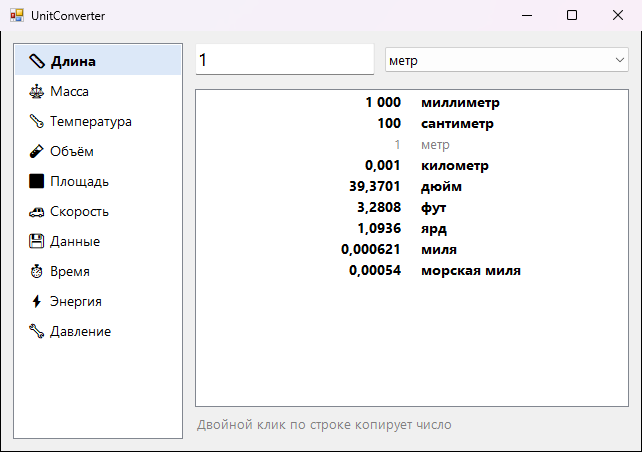

<div align="center">

# 📐 UnitConverter

**Конвертер единиц без интернета: вводишь число и сразу видишь его во всех единицах**




</div>

## ✨ Возможности

- 🗂️ 10 категорий: длина, масса, температура, объём, площадь, скорость, данные, время, энергия, давление
- ⚡ Результат сразу во всех единицах категории, без выбора «из чего во что»
- 🏡 Привычные единицы: сотки, гектары, центнеры, стаканы и ложки, мм рт. ст., килокалории
- 🇺🇸 Американские и британские: дюймы, футы, мили, фунты, унции, галлоны, psi, °F
- ✍️ Дробь можно писать и через запятую, и через точку. Пробелы в числе не мешают
- 📋 Двойной клик или `Ctrl+C` копирует результат

## 💡 Когда пригодится

- Рецепт в чашках и унциях, а у тебя весы в граммах
- Размер телевизора или монитора в дюймах
- Сколько гигабайт в тарифе на мегабитах, сколько соток в гектаре и прочие бытовые вопросы

## 📥 Установка

1. Скачай `UnitConverter.exe` из раздела [**Releases**](../../releases/latest)
2. Запусти его, установка не нужна

## 🛠️ Сборка из исходников

Нужен только Windows: компилятор C# входит в состав .NET Framework.

```bat
build.bat
```

## 📄 Лицензия

[MIT](LICENSE)
